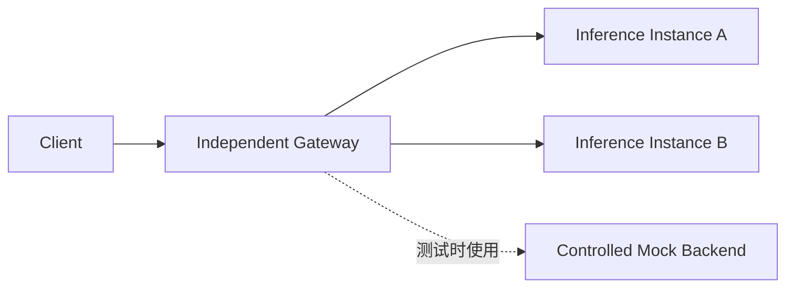

# AI Inference L7 Gateway 架构大纲

文档状态：`Approved`（总体架构基线；V0.1基础代理/上游复用及V0.2/S1流链路、S2背压协同已验收，V0.2/S3固定真实CPU后端验证已验收，调度等后续能力未交付）。创建日期：2026-10-17；采纳日期：2026-10-18。

## 1. 依据与状态

用户于 2026-10-17 确认“独立项目、按需复用、最后联调”，于 2026-10-18 授权“你来决策吧”。Leader 据此采纳总体架构，并制定 V0.1/S1 的详细技术基线；后续阶段仍须形成各自设计。授权不等于已实现或已通过 Reviewer 验收。

2026-10-17 首次编写前，仓库仅有空 README 和 Git 初始提交。2026-10-18，V0.1/S1 已通过 [Reviewer 002 独立复验](docs/reviewer/reports/V0.1/S1-report-002.md)，由 Leader 003 收口，最新状态澄清见 [Leader 004](docs/leader/reports/V0.1/S1-report-004.md)。已验收实现为S1最小组件/协议基础、S2单上游非流式代理及S3有界上游连接复用；V0.2/S1增量流链路及S2背压协同亦已接受，固定CPU真实后端亦完成验证，调度仍为后续目标。S1已提交bb318d8c并推送至阶段分支（协调者核验），未合并main或发布。S2按[返工002](docs/leader/reworks/rework-002.md)修正后通过[Reviewer002](docs/reviewer/reports/V0.1/S2-report-002.md)，由[Leader003](docs/leader/reports/V0.1/S2-report-003.md)收口；S2已本地提交3cb65244312d2feef563c2fd755ae8447d4589c5，远端状态本轮未核验。用户于2026-10-19启动S3，已通过[Reviewer002 PASS](docs/reviewer/reports/V0.1/S3-report-002.md)并由[Leader002](docs/leader/reports/V0.1/S3-report-002.md)收口；S3及V0.1开发验收已完成，提交d653e9c400517783d5d33025a0b66a737c8256eb已推送阶段分支（协调者2026-10-19核验同SHA）；当前V0.2/S1已获[Reviewer002 PASS](docs/reviewer/reports/V0.2/S1-report-002.md)并由[Leader002](docs/leader/reports/V0.2/S1-report-002.md)收口，累计1/2；V0.2/S1已本地提交2f7cf831a302fc87717afcae510e777187c7d0ef，远端本轮未核验；V0.2开发验收已完成；S2经[Reviewer001 PASS](docs/reviewer/reports/V0.2/S2-report-001.md)和[Leader002](docs/leader/reports/V0.2/S2-report-002.md)收口，累计0/2、无债；S2已本地提交d933e8892033a600b68ff5ac0db950dec5abea90、远端本轮未核验；S3经[Reviewer002 PASS](docs/reviewer/reports/V0.2/S3-report-002.md)和[Leader002](docs/leader/reports/V0.2/S3-report-002.md)收口，累计2/2、无债；待协调者本地提交、不推送，V0.3未开始。版本顺序、阶段范围和完成条件由 [ROADMAP.md](ROADMAP.md) 维护。

## 2. 项目目标与边界

Gateway 是独立进程，面向在线文本推理请求提供 HTTP 代理、流式传输、模型路由和有限容量下的准入控制。主要工程问题是：在长请求、慢客户端、取消、后端故障和过载共同存在时，保证协议正确、资源有界，并能解释性能表现。

独立运行不要求启动原 HTTP Server 或 L4LB，不要求把三个项目合并为一个仓库。

规划内：HTTP/1.1、一个明确的文本推理 API 子集、SSE 与非流式响应、静态模型映射、多后端选择、有界排队、超时取消和性能实验。

长期非目标：模型训练与推理引擎、CUDA Kernel、完整分布式模型调度平台、Kubernetes 控制面、完整 Service Mesh、计费平台、自研 TCP/IP 协议栈。DPDK、RDMA 不作为当前网关依赖。

当前规划不包含：HTTP/2、HTTP/3、TLS 终止、多模态、通用协议转换、自动重试、服务发现、分布式全局配额。首版面向受控实验环境；公网服务的认证、TLS 和隔离需求须另行设计。

## 3. 运行拓扑

模拟后端与真实后端使用相同的已选 API 契约接入；图中虚线表示测试替代关系。一个实例可以使用一张或多张 GPU，也可使用其他执行环境。

后期联调链路为 `Client → L4LB TCP Proxy → Multiple Gateways → Inference Backends`。L4LB 按 TCP 连接选择 Gateway，Gateway 按 HTTP 请求选择推理实例。L4LB 连接分布均匀不保证请求成本均匀。

2026-10-14 的参考仓库检查确认当时的 XDP 路径是 UDP DSR；HTTP/SSE 联调计划使用 TCP 代理路径。正式联调时重新核对版本与能力，不把历史检查当作未来能力承诺。

## 4. 技术方向与待定事项

- 采用 Linux、C++20、非阻塞 Socket、LT epoll、Reactor/EventLoop、CMake；首个执行环境为 WSL2 Linux。先验证单 Worker，不引入另一套网络框架。
- HTTP 增量解析选择 llhttp 9.4.3 的生成 C 源码，JSON 选择 nlohmann/json 3.12.0。只在薄适配层使用第三方接口，保持严格 HTTP 校验；依赖已在 S1 固定源码快照、校验和及许可证，并经 Reviewer 002 独立 Debug/Release/ASan+UBSan 构建与测试验证。
- 首先以单 Worker 验证请求状态和资源边界；多 Worker 由性能证据驱动，采用相同请求归属规则。
- 首版启动时加载静态配置；事件循环内不执行阻塞 DNS、同步磁盘写入或后端指标抓取。
- 首个 API 为 `POST /v1/chat/completions` 的文本、单结果子集；V0.1 支持非流式，V0.2 增加流式。V0.1 的精确字段、协议处理和限制见 [S1 设计](docs/leader/designs/V0.1/S1-design.md)，不声称完整 OpenAI API 兼容。
- 真实后端优先评估 vLLM；算力不可用时可选其他兼容端点验证协议，但不能替代真实多实例 GPU 调度证据。Ollama 原生 NDJSON 与 SSE 不混为一种协议。

## 5. 模块职责与依赖

以下为目标模块职责。S1 已创建 `src/base/`、`src/net/`（Socket）、`src/timer/`、`src/http/` 和 `src/gateway/`（文本请求校验），以及测试设施；S2已新增src/app配置/信号/main、src/net事件循环以及src/gateway的代理会话/运行时。S3新增src/upstream连接池/唯一租约，Runtime装配池、会话编排请求；routing/admission/observability独立模块尚未交付，表中健康/调度等长期目标职责不代表已全部交付。头文件与实现文件默认在模块内同目录组织。C++ 命名、回调、状态结果和排版统一引用用户技能目录中的 `personal-cpp-standards`，不在项目内复制规则。

| 建议模块 | 职责与状态归属 | 不承担的职责 |
| --- | --- | --- |
| `src/app/` | 启动装配、配置验证、停止与排空流程 | 协议解析、路由算法 |
| `src/net/` | Socket/FD、事件循环、连接、收发缓冲 | 模型、队列和推理语义 |
| `src/http/` | 请求/响应增量解析、消息边界、头处理、编码 | 实例选择和模型计算 |
| `src/gateway/` | 代理请求上下文、双连接协同、超时与终结 | 直接实现轮询等选择算法 |
| `src/routing/` | 静态模型映射、健康过滤、候选选择规则 | 直接操作 Socket、绕过准入 |
| `src/admission/` | 容量预约、每模型队列、排队截止时间 | HTTP 编解码和后端计算调度 |
| `src/upstream/` | 异步建连、连接租约、连接池、健康观测 | 客户端协议兼容政策 |
| `src/observability/` | 有界指标与诊断记录、阶段时间点 | 改变业务成功/失败判定 |

依赖方向：`app` 装配各模块；`gateway` 编排 `http`、`routing`、`admission`、`upstream`；`http` 不依赖业务路由；`upstream` 使用 `net`；`net` 不反向依赖网关业务。

路由策略接收候选快照并返回选择结果；准入模块负责容量是否允许派发。后端可变运行状态由所属 Worker 内明确的运行时对象维护，各模块通过受控操作读取或变更，不能分别维护互相冲突的 inflight 真值。

复用组件通过网关内的适配边界接入，避免业务代码直接依赖旧项目服务入口。具体类型和公开接口留给阶段设计，不提前创建大量空类。

## 6. 请求主流程

以下为长期目标流程。已验收V0.1校验一个下游请求、租用或连接静态唯一上游、完整收取有界非流式响应并回传；上游允许跨下游会话顺序复用，下游仍单请求关闭，不执行模型选路、排队或流式高低水位控制。

1. 接收连接并检查连接额度，以有限头部和请求体预算增量读取 HTTP 请求。
2. 在请求体上限内完成 JSON 校验，提取 `model`、流式标志等必要元数据；默认保留正文语义，不做厂商格式转换。
3. 查找模型实例组，过滤不可用实例；根据容量决定立即派发、进入有界队列或拒绝。队列按模型组织，出队时重新选实例，避免等待请求绑定故障后端。
4. 原子地选定并预约实例容量，获取上游连接或异步建连，转发请求。借用空闲连接和新建连接使用同一总截止时间。
5. 增量处理响应头和正文；下游写缓冲达到高水位时暂停对应上游读取，回落到低水位时恢复。
6. 上游响应完成后，根据协议状态归还或关闭上游连接；下游剩余数据继续受缓冲预算和写进展超时约束。
7. 正常结束、错误、取消和超时进入统一的终结路径，恰好一次释放相应资源与额度，并记录结束原因。

首版每条 HTTP/1.1 连接同时处理一个请求；顺序 keep-alive 不等于 pipelining。协议契约明确流水线输入的处理，不允许请求串扰或把额外字节误作正文。

## 7. 所有权、并发与生命周期

- Worker 持有连接注册表和请求注册表；一条代理请求的上下游由同一个 EventLoop 处理。
- 请求上下文维护状态、截止时间、路由结果和连接租约，使用稳定身份区分延迟事件，不能只依赖可复用的 FD 数值。
- 空闲上游连接由池持有；租出后同一连接只服务一个活动请求，禁止同时绑定两个请求。
- 回调不能通过上下游互相强引用形成环；对象销毁后不得由定时器或排队任务继续访问。执行上下文和销毁责任须在阶段设计中明确。
- 连接状态、请求状态、背压状态和容量计数分开表达。TCP 半关闭不直接判定为取消。
- 上游请求完成、网关请求终结、下游缓冲清空是不同事件；后端本地 inflight 与网关活跃资源分别计数。
- 错误、超时与正常完成竞争时，只有一次终结能结算资源；后续事件不得重复释放连接或额度。
- 多 Worker 引入前，必须确定单进程限额的共享预约或预算分片方式；不能把每 Worker 限额误称为进程总限额。
- 多 Gateway 的本地限额不构成集群全局配额。连接取消后的本地计数不代表远端 GPU 已停止计算。

停止流程：停止接入和新派发，按明确策略终结等待请求，给予活动请求有限排空时间，最后取消并回收残余连接、任务和定时器。

## 8. 协议与错误边界

HTTP 层必须明确处理请求体长度、响应消息边界、chunked、连接关闭定界、无正文响应及逐跳头。冲突的长度信息、畸形分块、截断正文和超限输入进入可测试的拒绝/终止路径。未支持的请求形式明确拒绝，不静默猜测边界。

SSE 正文默认透明增量转发，不要求等完整 event。TCP 分片、HTTP chunk、SSE event、模型 token 的边界彼此独立。可选事件观察器只负责观测，并有独立的缓存上限，不能阻塞转发主路径。

最终响应开始之前，可生成明确的 HTTP 错误；响应开始之后不能再发送第二个状态行。此时记录中断原因并关闭或按已定义的流内语义结束，不伪造成功结束标志。

首版不自动重试推理请求：未收到响应不能证明后端未执行。若以后增加重试，必须另行定义可重试条件、幂等性和预算。

上游连接仅在响应完整消费、解析状态干净且持久连接条件满足时归池。取消、超时、协议异常或有未解释残留数据的连接关闭。

模型只映射到配置允许的后端，不接受客户端直接指定任意上游地址。默认不记录 prompt、完整响应或凭据；日志、指标标签和诊断队列也需要容量边界。

## 9. 资源控制、背压与超时

资源预算同时覆盖：连接数、活动请求数、每实例容量、等待请求数与总字节数、请求头/体大小、单请求及全进程缓冲、空闲上游连接、指标与日志队列。

高低水位提供暂停/恢复滞回，硬容量限制保证每次读取和追加不能越界。队列中的请求体也计入总预算。用户态缓冲上界不等于进程 RSS 或内核 Socket 内存上界；验收要分别报告可控缓冲、实际 RSS 和相关系统配置。

暂停上游读取只传递传输层压力，不保证推理引擎暂停生成。慢客户端达到无进展或总时长限制后终止请求；只有后端证据才能支持“计算已停止”的结论。

分类截止时间包括：请求接收、排队、连接池等待/建连、请求发送、首响应等待、流空闲、下游写无进展和请求总时长。采用单调时钟，阶段切换不重置总截止时间。

主动背压暂停期间，不能用“未读到上游数据”单独认定后端卡死；暂停状态由下游进展和总截止时间约束。首字节与首输出 token 分开定义；普通字节转发层只直接承诺字节级观测。

## 10. 复用边界

优先审查 Socket/FD 管理、Buffer、EventLoop 和定时器；参考 L4LB 的异步建连、双向背压与半关闭处理。代理请求状态、HTTP 双向解析、上游池、模型路由和准入由 Gateway 自己负责。

2026-10-14 对 Server 的检查显示，当时请求解析器只接受 GET 和零长度正文，并拒绝 Transfer-Encoding/Expect。该历史观察支持“不能直接沿用其 HTTP 服务层”的初步判断，具体接口与能力在复用前重新检查。

复用前必须记录来源仓库、提交、许可证、依赖闭包、已有测试和需要补充的语义。不得把其他工作区未提交修改当成稳定公共接口。

S1 已受控迁入 Server 固定提交中的 Buffer、Socket、TimerQueue 及其最小依赖，原始快照和适配差异均记录来源。S2 经固定提交闭包核查，决定受控迁入EventLoop/Channel/Epoller六文件；绑定已有TimerQueue/NonCopyable，保留事件token和回调后清理语义。S2事件组件已迁入并随阶段通过独立复验，不迁入Server完整服务层或L4LB整个转发器。新仓库可独立构建，不把同时重构旧项目作为启动前提。

## 11. 可观测性与验证架构

记录请求进入、完成解析、入队、出队、连接可用、请求发送、首响应、上游完成、下游排空和终结等阶段时间点。排队、连接等待、上游等待和下游排空分别统计，避免重叠计时后直接求和。

- 客户端负责端到端 TTFT、完成时间和流完整性；TTFT 必须声明首个有效输出的识别规则。
- 网关直接观测连接、请求、队列、字节、资源预算及本地阶段耗时。写入 Socket 不代表客户端收到。
- 后端计算、内部排队和真实 token 数依赖后端或可靠 API 证据，不能由 SSE event 数推断。
- 单机使用单调时钟计算时长；跨机归因需匹配请求标识和明确时钟误差，不能直接相减未同步时钟。

测试分为协议/状态单元测试、可控 Socket 集成测试、故障/慢客户端回归和独立性能实验。HTTP 输入按任意字节边界切分；重点验证取消与超时竞争、归池污染、内存上界和故障后的恢复。

模拟后端分为传输模拟器与容量模拟器：前者控制分片、延迟、断连；后者建模有限执行容量和请求成本。模拟结论明确其模型假设，不能推导真实 GPU 收益。

性能证据分开报告代理成本、资源稳定性和调度效果。固定工作负载、随机种子、连接模式、到达过程、预热和重复方法；保留失败与拒绝，不只统计成功样本。两组 P99 相减不是代理附加延迟的 P99。

## 12. 阶段设计与当前边界

解析库、组件引入方式、V0.1 API/HTTP 子集和 S1 验收已在 [S1 设计](docs/leader/designs/V0.1/S1-design.md) 收敛。S1 已验证依赖构建、最小组件和协议适配；[返工 001](docs/leader/reworks/rework-001.md) 明确了合法 chunk 扩展的前置有界校验，原始预算和消费偏移保持不变。S2已按用户新授权形成[Approved设计](docs/leader/designs/V0.1/S2-design.md)，已结合返工002通过独立验证。

S2设计已定量化运行时预算和分类截止时间：单线程、静态IPv4、每请求新建上游连接、完整有界非流式响应、保守会话预约和有限停止。S2已通过阶段独立验收；[S3设计](docs/leader/designs/V0.1/S3-design.md)已批准有界上游连接池、跨下游会话顺序复用与初始成本实验，已实现并独立验收；下游继续单请求关闭。S3采用保守租约持有至下游输出提交并成功SHUT_WR，idle由池管理，取消/超时/污染不得归池；不改变上述模块责任或引入排队。真实后端版本在V0.2冻结。引入重大依赖、改变兼容范围或跨项目修改时，先更新具体方案与影响，再按阶段基线推进。

## 变更记录

- 2026-10-17：依据用户已确认的独立定位创建初版大纲；技术建议保留为 Draft，明确复用审查和末期 L4 联调边界。
- 2026-10-18：Leader 根据用户决策授权采纳总体架构，确定 C++20、LT epoll、llhttp、nlohmann/json 和 S1 最小组件迁入；实现与性能仍待验证。

- 2026-10-18：S1 经独立 PASS 后同步实际实现边界，区分已验收协议/组件与后续运行拓扑，架构范围未扩展。

- 2026-10-18：Leader 004 纠正收口时遗漏的“依赖未构建/目录尚未创建”当前描述；产品验收仍为 Reviewer 002，未变更实现或架构范围。

- 2026-10-18：用户启动S2，采纳固定事件组件迁入与单上游非流式生命周期设计；只更新已批准方向，尚无S2运行证据。

- 2026-10-18：S2返工002明确完整响应后的写半关闭与有界读排空，保留单请求、全额预约和绝对deadline；当前仍待复验。

## 已验收运行时接口边界

S2交付接口为独立程序与SIGINT/SIGTERM停止；main仅启动监听和事件循环。内部GatewayRuntime的requestShutdown要求经业务事件/计时回调后的cleanup完成即时注册表与预约清理，不作为通用嵌入式SDK提供。

Reviewer独立复现：在owner线程但事件回调外连续调用两次requestShutdown再pollOnce，Socket/Channel已结束而快照仍active=1、reserved=16777216、timers=0；Runtime析构清空对象与预约。实际signalfd及停止定时器路径均经cleanup，已验证快照归零。Leader据原设计§4/§8的进程接口边界判定此限制不阻塞S2，不把事件外调用宣称为已验收；以后暴露Runtime嵌入接口前须定义并验证相应清理保证。

- 2026-10-18：S2独立PASS后同步已实现模块与目标流程边界，显式记录Runtime内部调用限制；不扩展为SDK或完成S3。

- 2026-10-19：按用户启动S3与技术委托记录已批准的上游池/下游单请求边界，实际实现仍为S2；同步S2本地提交事实，不推断远端或发布。

## 已验收上游池边界

ConnectionPool唯一拥有上游Socket/Channel，会话持有move-only租约；空闲/租用转换更新事件token和generation，回调返回后cleanup删除退休对象。总量/idle/期限由独立配置约束；idle不保存协议正文，默认16/16/5000ms，池满503且无队列。请求发送完整、响应明确定界且无关闭/污染/异常、下游成功SHUT_WR后才归池，旧下游closing不再持有租约。此为非流式复用路径，比长期流程第6步更保守，慢客户端发送期间保持上游槽；V0.2/S1的stream=true路径结束一律失效租约，不归池。

归还/租出前非阻塞peek与idle读事件淘汰当前可探测污染，借出后失败不重试；不保证未来存活或任意恶意后端未来响应的因果识别。首次停止关闭idle并阻止新派发，已有租约有限排空，第二信号/停止期限强制收口。完整资源/事件/停止边界见S3设计；上述内部Runtime SDK使用限制仍适用。

- 2026-10-19：S3独立PASS后同步实际池模块、顺序复用和资格/资源边界；V0.1开发验收已完成，后续流式/调度未实现，未发布。

## V0.2/S1 已验收流式链路

[V0.2/S1设计](docs/leader/designs/V0.2/S1-design.md)按用户启动授权收敛首阶段：HttpParser提供已验证最终头/解码body片段/终态，ProxySession按stream请求与响应Content-Type选择流或有界缓冲回退；流体不累计于HttpMessage.body。流模式头规范化为chunked+close，按当前可用字节输出，HTTP完成才发送终止块，不解析SSE event或[DONE]。

首个final字节被Socket接受才算响应已开始，入队头尚可在失败时撤回；开始后异常只中断，不生成第二状态行或正常终止块。流请求本阶段使用受限租约但结束不归池，原非流式复用保持。固定pending256KiB、总解码8MiB/wire16MiB及已有16MiB会话预约/绝对期限控制资源；S1历史版本满缓存结束，当前S2已替换为高低水位暂停恢复。上述已按V0.2/S1权威实现并独立接受；新增StreamOutput固定数组承载pending，HttpParser固定片段不累计body，ProxySession管理响应提交/完成；S1历史批次期限已由S2流写无进展期限替换，非流式保持。流HTTP完成转换前重查response/total期限，不能先撤除过期期限再发零chunk。

- 2026-10-19：用户启动V0.2/S1，明确协议增量接口/不累计流body、发送commit point和有限S1边界；流实现/验收待完成，不改V0.1历史权威。

- 2026-10-19：V0.2/S1独立PASS后同步实际流解析/固定输出/提交及完成期限边界；高低水位协同仍留S2，真实后端留S3，V0.2未完成。

## V0.2/S2 已验收背压协同

[S2设计](docs/leader/designs/V0.2/S2-design.md)在现有StreamOutput固定256KiB数组上引入默认192/64KiB高低水位。ProxySession管理暂停/恢复；ConnectionLease显式DEL上游channel，恢复重新注册token，避免仅interest=0无法屏蔽HUP/ERR导致LT忙转。暂停时上游关闭可延后到恢复观察，response/total和下游无进展期限持续有效，不保证即时取消发现。

Runtime统一拥有所有会话16MiB保守预约及默认4MiB的SSE固定数组容量子账本；分配前取额度、销毁后退，pending为空也计完整容量，子预算属于总预约内而非额外可分配内存。请求/元数据/非流式字符串仍须以当前标准库实际capacity证明落在保守预约内；不把账本等同RSS或内核内存。

流写deadline从S1连续非空批次绝对窗口改为有效send进展窗口，非流式及非SSE回退保持；新增stream_idle只按解码body进展刷新，主动暂停冻结剩余量。response/total绝对期限和完成转换前检查保持，强制停止/finished优先于任何恢复。普通SHUT_WR不是取消；S3仅验证固定CPU后端slot，未证明GPU计算停止。上述实现已独立验收；BufferBudget/CapacityLease在gateway内部维护唯一账本与幂等凭证，Runtime预算寿命覆盖会话，数组销毁后退容量、会话销毁后退预约。相关快照为内部验证接口，不扩展嵌入式SDK承诺。

- 2026-10-19：用户启动V0.2/S2，按既有技术委托采纳背压/容量/取消与期限协同设计；未声明新能力已实现或V0.2完成。

- 2026-10-19：V0.2/S2独立初审PASS，0/2、无债，实际可恢复背压/容量/分类期限与取消协同已验收；不据有限合成工作负载推导严格公平、RSS或GPU保证。V0.2仍待S3。

## V0.2/S3 已验收真实后端验证

[S3设计](docs/leader/designs/V0.2/S3-design.md)选择固定llama.cpp b7481 CPU服务和Qwen2.5-0.5B-Instruct Q4_K_M，使用现有/v1/chat/completions子集；不安装CUDA栈、不新增网关依赖或厂商转换。固定资产与模型实际加载、真实流/非流接口、取消及故障恢复已经独立验证；普通构建与CTest仍不依赖模型。

真实模型测试与确定性模拟压力分别验证协议适配/取消观察和可控高水/错帧/资源回归。测试host可读取同负载Runtime快照，产品不新增管理API。取消记录本地资源、上游连接、后端slot/任务各自证据，CPU小模型结果不支持GPU停止或多实例调度结论。实际版本、许可证、SHA和600秒/300秒等预定验收边界由S3权威维护，V0.2开发验收已完成。新增tests/integration提供同库RuntimeHost、原始HTTP/SSE检测及有界资源/attempt记录；产品src未因本阶段改变。

- 2026-10-19：用户启动S3并授权选择最小真实后端，采纳固定CPU小模型与分离稳定性矩阵；当前仅资产准备，不提前验收或发布。

- 2026-10-19：S3最终独立PASS关闭异常attempt取证缺口，累计2/2。按身份复用独立真实601.662s/1270和模拟310.192s/650及三套13/13；最后一轮仅快测2/2与真实87/模拟50短校准。当前14入口不冒称全量实跑；V0.2开发验收完成，未发布，不启动V0.3。
